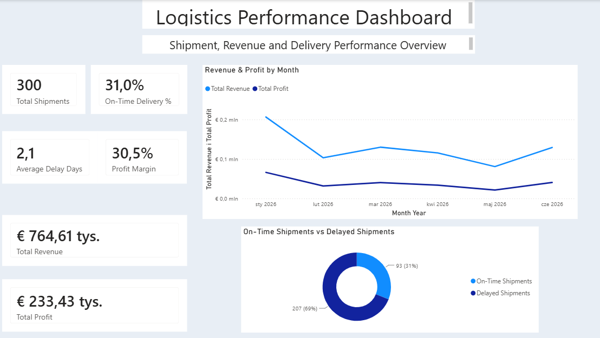
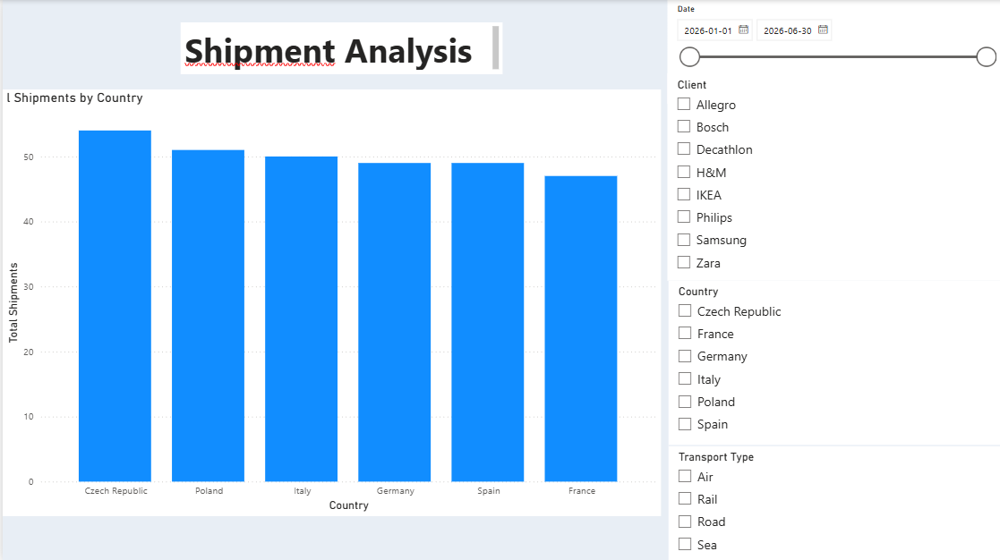
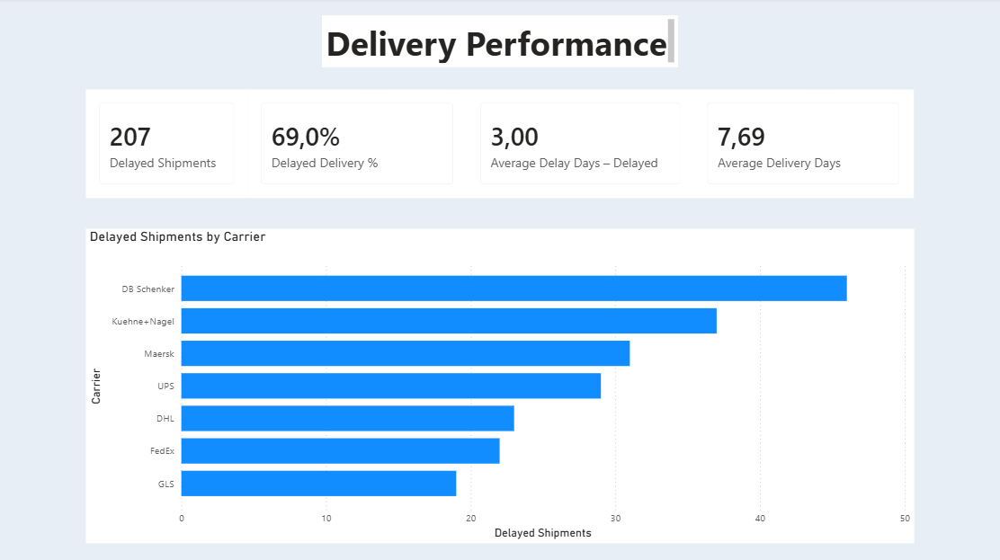
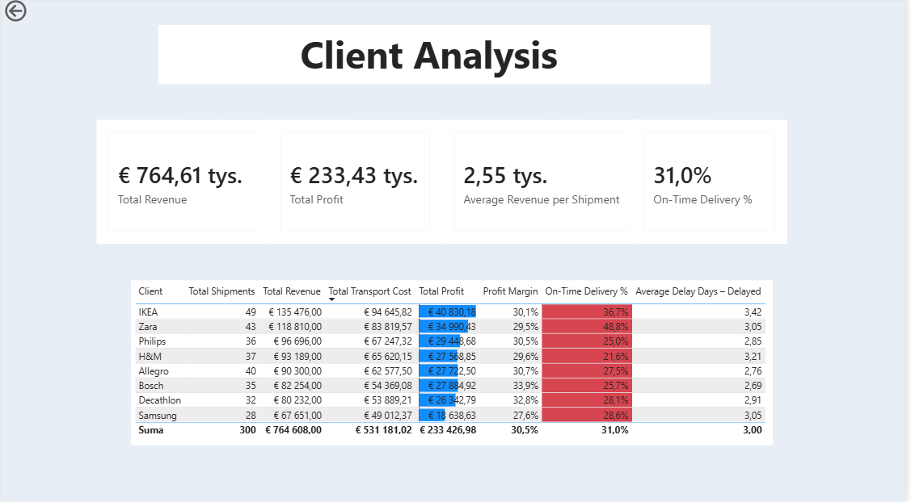
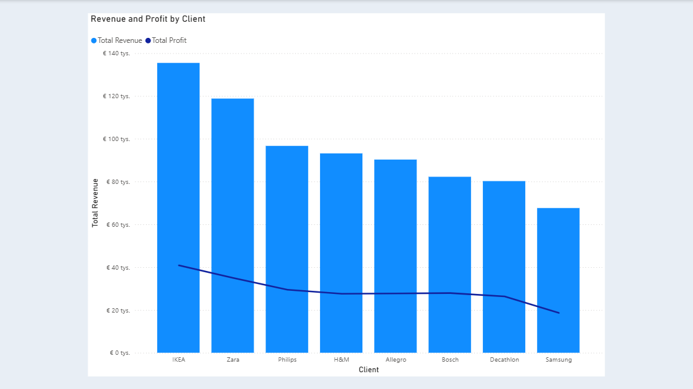
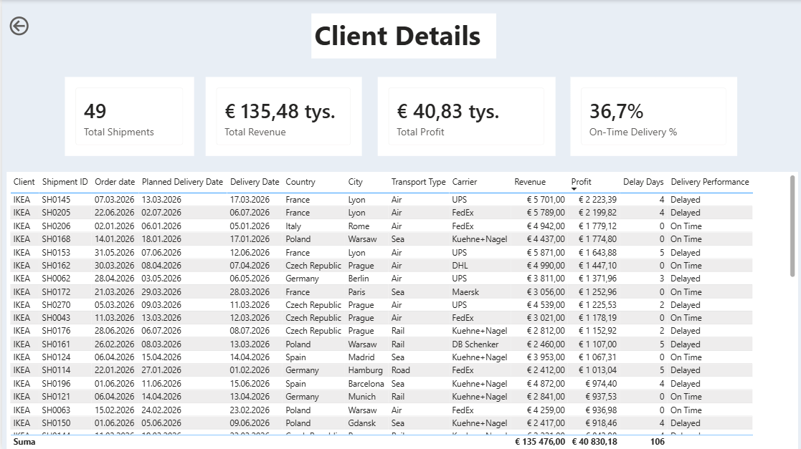

# Logistics Performance Dashboard | Power BI

An interactive Power BI report exploring logistics operations, delivery reliability, and client profitability using a **synthetic dataset of 300 shipments**. This is a portfolio/learning project; the data does not represent a real company or actual customers.

## Project overview

The dashboard brings shipment, delivery, and financial metrics together to help answer questions such as:

- How many shipments were handled, and how much revenue and profit did they generate?
- What proportion of deliveries arrived on time?
- Where are delays occurring, and how do delivery results differ across logistics dimensions?
- Which clients contribute the most revenue and profit?

## Tools and techniques

- **Power BI Desktop** — report development and interactive visuals
- **Power Query** — data cleaning and transformation
- **DAX** — KPI measures and calculated metrics
- **Data modeling** — a calendar table and date relationship
- **Excel** — source data
- **Drill-through** — navigation from client summaries to shipment-level details

## KPI snapshot

| Metric | Value |
| --- | ---: |
| Total shipments | 300 |
| Total revenue | €764,608 |
| Total profit | €233,426.98 |
| On-time delivery rate | 31% |

*All figures are calculated from the synthetic dataset used in this project.*

## Report pages

The report contains 11 pages:

1. Executive Overview
2. Shipment Analysis
3. Logistic Operations Analysis
4. Delivery Performance
5. On-Time Delivery Analysis
6. Delivery Delay Analysis
7. Client Analysis
8. Client Revenue & Profit
9. Performance Analysis
10. Shipment Details
11. Client Details

## Selected observations

- **31% of shipments were delivered on time** in the sample, highlighting delivery reliability as an area for investigation.
- The sample generated **€764,608 in revenue** and **€233,426.98 in profit**.
- Client-level views make it possible to compare revenue, profit, margin, and delivery performance; drill-through provides shipment-level context.

These are descriptive observations from simulated data, not conclusions about real-world logistics performance.

## Dashboard screenshots

### Executive Overview

### Shipment Analysis

### Delivery Performance

### Client Analysis

### Client Revenue & Profit

### Client Details (drill-through example)

## How to explore

1. Download `Logistics_Performance_Dashboard.pbix`.
2. Open it in **Power BI Desktop**.
3. Explore the report pages and interact with the available filters and visuals.
4. On **Client Analysis**, use the client drill-through action to open **Client Details**.

## Notes

- **Data source:** synthetic/sample shipment data created for learning and demonstration.
- **Purpose:** demonstrate reporting, data preparation, modeling, DAX, and business-oriented analysis.
- **Privacy:** no real client or business information is included in the sample dataset.
